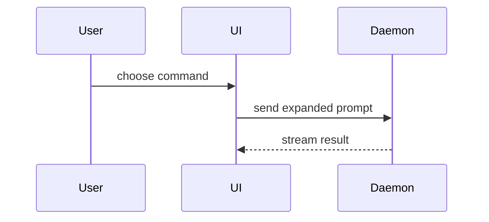

Utilisez ce modèle pour rédiger le corps de la pull request :

```markdown
## Résumé

<diagramme, croquis de diff ou arbre>

## Preuves

- **Avant :** <capture d'écran/sortie/exécution de test en échec>
  **Après :** <capture d'écran/sortie/exécution de test réussie>

## Danger du merge

**Porte :** <à sens unique ou à double sens>

<facultatif : description>

**Rayon d'impact :** <description en un mot>

<facultatif : ramifications potentielles du merge>
```

## Sections

Sautez tous les préambules et restez bref dans la prose. Utilisez le langage de domaine de l'utilisateur, issu de `GLOSSARY.md`.

### Résumé

Choisissez la plus petite vue qui rend le point clé clair.

- Montrez la logique ou un algorithme en pseudocode :

```text
on(save)
  if content is unchanged
    return cached result
  write new content
  return fresh result
```

- Montrez le flux de contrôle à l'exécution sous forme d'arbre d'appels :

```text
submitForm
  createSession
    persistPrompt
    launchAgent
  navigateToSession
```

- Montrez la structure de l'UI sous forme d'arbre de composants, en incluant l'état et les frontières de modules qui comptent :

```text
<SessionPage> (apps/example/src/routes/session.tsx)
  useSessionEvents()
  <SessionToolbar>
    <RunSkillButton> (packages/ui)
```

- Montrez la responsabilité d'un fichier ou un refactoring large sous forme d'arbre de fichiers superficiel :

```text
src/
├── commands/       # parses user actions
├── sessions/       # owns session state
└── transport/      # sends API requests
```

- Montrez l'interaction entre composants, le flux de contrôle ou le flux de données avec Mermaid :



- Utilisez `diff` quand le point est ce qui change et que la forme environnante existe déjà. Faites correspondre la forme du diff au sujet.

Pour un changement de composant :

```diff
 <SessionPage>
   useSessionEvents()
   <SessionToolbar>
+    <RunSkillButton />
   <SessionTimeline>
+    <SkillResultCard />
```

Pour un changement d'agencement de fichiers :

```diff
 src/
 ├── commands/
+│   └── show-me.ts       # expands the slash command
 ├── sessions/
-└── transport.ts
+└── transport/
+    ├── client.ts
+    └── stream.ts
```

Pour un changement d'arbre d'appels ou de pile d'appels :

```diff
 submitForm
   createSession
     persistPrompt
+    expandSkillMention
     launchAgent
-  navigateToSession
+  navigateToSession
+    subscribeToEvents
```

Pour un changement d'état ou de flux de contrôle :

```diff
 on(save)
-  write content
+  if content is unchanged
+    return cached result
+  write new content
+  invalidate cache
```

- Montrez le bloc entier quand l'essentiel est nouveau, quand le contexte omis masquerait la propriété ou l'ordre, ou quand l'utilisateur a besoin d'une forme cible copiable :

```ts
function expandSkill(command: string): string {
  const skillName = command.slice(1);
  return `use the ${skillName} skill`;
}
```

#### Conseils

Placez chaque visuel à côté du court texte qu'il étaye. Ne gardez que les appels, fichiers, props, états et frontières nécessaires pour répondre à la question actuelle de l'utilisateur ou aux options permettant de résoudre le point de discussion en cours.

Vous pouvez en utiliser un, vous pouvez en utiliser plusieurs, il est peu probable que vous les utilisiez tous. Faites preuve de jugement et ne submergez pas l'utilisateur.

### Preuves

Des preuves concrètes que le changement fonctionne. Montrez un avant et un après.

Les captures d'écran sont de rang S, quand l'environnement est configuré pour cela et que le changement est visuel.

Les preuves issues de l'exécution sont de rang A. Résultats de tests, sortie console. Montrez le test exact qui échoue désormais et passe, en pseudocode.

### Danger du merge

Décrivez s'il s'agit d'une porte à sens unique ou d'une porte à double sens. On peut revenir en arrière par une porte à double sens, pas par une porte à sens unique. Une PR dont le retour en arrière est peu coûteux est moins risquée. Les changements qui impliquent des actions destructrices ou des décisions difficiles à inverser sont des portes à sens unique.

Le rayon d'impact est l'effet potentiel ou la portée des changements introduits par cette PR. Envisagez toutes les possibilités. Des exemples sont un décalage de mise en page, des casses pour les consommateurs, la réactivité mobile, etc.
